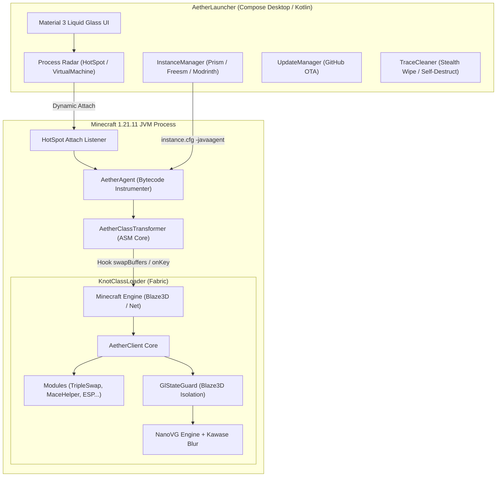

# AetherClient & AetherLauncher

<div align="center">

```
   _____        __  __                  _____ _ _            _   
  / ____|      | | |  |                / ____| (_)          | |  
 | (___   ___  | |_| |__   ___ _ __   | |    | |_  ___ _ __ | |_ 
  \___ \ / _ \ | __| '_ \ / _ \ '__|  | |    | | |/ _ \ '_ \| __|
  ____) |  __/ | |_| | | |  __/ |     | |____| | |  __/ | | | |_ 
 |_____/ \___|  \__|_| |_|\___|_|      \_____|_|_|\___|_| |_|\__|
```

**Next-Generation Liquid Glass Minecraft 1.21.11 Fabric Client & Native Desktop Launcher**

[](https://github.com/blinoed-UWU/AetherClient/releases)
[](https://fabricmc.net/)
[](https://fabricmc.net/)
[](https://openjdk.org/)
[](https://kotlinlang.org/)
[](https://github.com/blinoed-UWU/AetherClient/releases)
[](LICENSE)

*Engineered with NanoVG hardware acceleration, Dual Kawase Blur shaders, dynamic HotSpot JVM agent injection, and zero-flag stealth combat mechanics.*

[Features](#-key-features) • [Installation](#-installation) • [Build from Source](#-building-from-source) • [Architecture](#-architecture) • [Configuration](#-configuration--controls) • [Releases](https://github.com/blinoed-UWU/AetherClient/releases)

---

</div>

## 🌟 Key Features

### 💎 Liquid Glass User Interface
- **NanoVG Hardware Vector Engine**: Crystal-clear anti-aliased rendering at native display refresh rates without font texture tearing.
- **Dual Kawase Multi-Pass Blur**: GPU-accelerated background blur isolating menus and widgets from 3D world geometry.
- **Responsive Theme Engine**: Fluid color gradients, customizable accent hues, dynamic rounded corner geometry, and fully scalable HUD elements.
- **Interactive Drag & Snap HUD**: Pixel-perfect HUD repositioning with automatic grid magnetic snapping.

---

### ⚔️ Advanced Combat & Movement
- **Triple Radial Fast-Swap (`TripleSwap`)**:
  - Hold a single hotkey to deploy a sleek 3-way circular selector centered on your screen.
  - Automatically captures the cursor and safely locks player motion packets during swap.
  - Supports Totems, Strength Potions, Speed Potions, End Crystals, Golden Apples, Pearls, and Talismans.
  - Bypasses strict anti-cheat container flags via server-synchronized artificial screen states.
- **Mace Helper (`MaceHelper`)**:
  - Automatically times critical smashes based on real-time fall distance calculation.
  - Accounts for slow falling, cobweb dampening, and water contact to prevent failed triggers.
  - Auto-swaps to Wind Charge post-smash for instant elevation boost.
- **Fast Swap (`FastSwap`)**:
  - Dual-mode offhand priority swap between Totem of Undying and combat Spheres/Talismans.
  - Automatic hotbar fallback and inventory slot return tracking.
- **Silent Click Pearl (`ClickPearl`)**:
  - Seamlessly pulls Ender Pearls from inventory, aims, throws, and returns the previous weapon to hand without opening visible screens.
- **Auto Tool (`AutoTool`)**:
  - Intelligent weapon and tool selection based on target block hardness and efficiency enchantments.
  - Preserves tool durability ($\le 5$) to prevent accidental item breakage.

---

### 🔮 Visual Aesthetics & ESP
- **China Hat (`ChinaHat`)**:
  - Fully customizable 3D cone rendering above the player's head.
  - Configurable layer count (1–5), cone segments (16–64), radius, height, tip color gradient, and outer glow.
- **Pearl Predict (`PearlPredict`)**:
  - High-precision ballistic trajectory simulation accounting for gravity and drag coefficients.
  - Dynamic gradient flight arc, 3D target bounding box, and impact ground ring.
- **2D / 3D ESP & Tracers**:
  - Bounding box ESP with friend/enemy color awareness (`.friend add <name>`).
  - Real-time health bar visualization, equipped armor icons, and main-hand item name rendering.
- **Viewmodel Customizer (`Viewmodel`)**:
  - Independent main-hand and off-hand 3D positional transforms (X, Y, Z, Scale).
  - True hand mirroring: moving the slider symmetrically displaces both hands outwards.
- **Custom Swing Animations (`SwingAnimation`)**:
  - Multiple animation presets (Smooth, Block, Punch, Flap, Slash).
  - Disable equip resets on slot switch and attack-only swing suppression.
- **NoRender Overrides**:
  - Suppress screen-obstructing effects: Totem pop animation, Pumpkin overlay, blindness/fog, and explosion flashes.

---

### 📦 Utility & QoL
- **Inventory Arranger (`InventoryArranger`)**:
  - Instant one-click sorting into competitive layouts (Crystal PvP, Sword PvP, Totem Stack).
  - Auto-armor equipping and configurable trash cleaner.
- **Item Scroller (`ItemScroller`)**:
  - Mass-transfer items between containers via Shift+Ctrl and smooth mouse wheel drag.
- **Auto TP Accept (`AutoTpAccept`)**:
  - Automatically processes teleport requests from recognized friends while ignoring strangers.
- **Streamer Name Protect (`NameProtect`)**:
  - Masks player usernames locally in chat, tab lists, and nametags for privacy during streams.
- **Discord Rich Presence**:
  - Displays server IP, player ign, elapsed playtime, and client version without locking the JVM thread.

---

### 🚀 Desktop Native Launcher
- **Zero-Setup Dynamic Injection**:
  - Automatically discovers running Minecraft instances via JVM HotSpot Attach API.
  - Injects `aether-agent.jar` at runtime without restarting Minecraft.
- **Launcher Instance Integration**:
  - Native detection and one-click configuration of **PrismLauncher**, **FreesmLauncher**, **Modrinth App**, and **Official Minecraft**.
  - Automatically edits `instance.cfg` with correct `-javaagent:` parameters.
- **Stealth Trace Cleaner & Self-Destruction**:
  - Deep cleaning mode: shreds launcher logs, JVM temporary files, cache entries, and config directories.
  - Optional self-destruct function removing binaries and temporary files off disk.
- **One-Click Config Reset**:
  - Direct UI action to safely wipe or restore default settings in case of corrupted configurations.
- **Built-in OTA Auto-Updater**:
  - Queries GitHub Releases directly and delivers automated zero-downtime updates.

---

## 📥 Installation

Choose the distribution suited for your operating system:

| Platform | Format | Description | Direct Download |
| :--- | :---: | :--- | :---: |
| **Linux** | `.AppImage` | Portable self-contained binary with bundled JRE | [AetherLauncher.AppImage](https://github.com/blinoed-UWU/AetherClient/releases/latest/download/AetherLauncher.AppImage) |
| **Windows** | `.exe` | Native x64 launcher executable with embedded agent extraction | [AetherLauncher.exe](https://github.com/blinoed-UWU/AetherClient/releases/latest/download/AetherLauncher.exe) |
| **Cross-Platform** | `.jar` | Universal executable JAR (requires Java 21+) | [AetherLauncher.jar](https://github.com/blinoed-UWU/AetherClient/releases/latest/download/AetherLauncher.jar) |
| **Fabric Agent** | `.jar` | Standalone Java agent for custom JVM argument injection | [aether-agent.jar](https://github.com/blinoed-UWU/AetherClient/releases/latest/download/aether-agent.jar) |

### Option A: Native Launcher (Recommended)
1. Download **`AetherLauncher.AppImage`** (Linux) or **`AetherLauncher.exe`** (Windows).
2. On Linux, mark executable:
   ```bash
   chmod +x AetherLauncher.AppImage
   ./AetherLauncher.AppImage
   ```
3. Launch Minecraft 1.21.11 Fabric.
4. Click **Inject** (`Инжект`) on the dashboard or launch directly via your configured Prism/Freesm profile!

### Option B: Manual JVM Parameter (`-javaagent`)
Add the following parameter to your launcher's JVM arguments:
```bash
-javaagent:"/path/to/aether-agent.jar"
```

---

## 🛠️ Building from Source

### Prerequisites
- **JDK 21** or newer (Eclipse Temurin or OpenJDK recommended)
- **Git**
- **MinGW-w64** (Optional, for building the Windows `.exe` native launcher stub on Linux)

### Build Commands
Clone the repository:
```bash
git clone https://github.com/blinoed-UWU/AetherClient.git
cd AetherClient
```

Compile and package all sub-projects:
```bash
# 1. Build the shared reflection bridge
./gradlew :bridge:build

# 2. Compile Fabric client and remap Yarn mappings
./gradlew :client:compileJava :client:remapJar

# 3. Assemble stealth Java Agent
./gradlew :agent:assemble

# 4. Package Desktop Launcher UberJar & AppImage
./gradlew :launcher:packageUberJarForCurrentOS
./gradlew :launcher:packageAppImage
```

Compiled deliverables will be located in:
- `agent/build/libs/aether-agent.jar`
- `client/build/libs/aether-client-1.0.0.jar`
- `launcher/dist/AetherLauncher.AppImage`
- `launcher/dist/AetherLauncher.jar`
- `launcher/dist/AetherLauncher.exe`

---

## 🏛️ Architecture



---

## 🎮 Configuration & Controls

- **`Right Shift`**: Open / Close the Liquid Glass ClickGUI.
- **`Triple Swap Hotkey`** (Configurable in ClickGUI): Hold to invoke the 3-way circular selector.
- **In-Game Chat Commands**:
  - `.friend add <username>`: Add player to whitelist (bypasses ESP alert, enables AutoTpAccept).
  - `.friend remove <username>`: Remove player from whitelist.
  - `.friend list`: Display current friends list.
- **Config Storage**:
  - Linux: `~/.local/share/AetherClient/configs/`
  - Windows: `%APPDATA%\AetherClient\configs\`

---

## 📜 Multi-AI Audit & Continuous Improvement

AetherClient features an automated evaluation protocol for AI-assisted development. To run a secondary neural network audit on a staging branch, consult:
- **[`PROMPT_AUDIT_MASTER.md`](PROMPT_AUDIT_MASTER.md)**: Master evaluation directive for zero-regression audits, Yarn 1.21.11 validation, and performance profiling.

---

## ⚖️ License & Disclaimer

AetherClient is distributed under the **GNU General Public License v3.0**. See [`LICENSE`](LICENSE) for details.

*Disclaimer: AetherClient is an educational modding framework designed for research into JVM bytecode manipulation, advanced OpenGL shaders, and modern desktop UI engineering. Use responsibly on servers where client modifications are explicitly permitted.*
